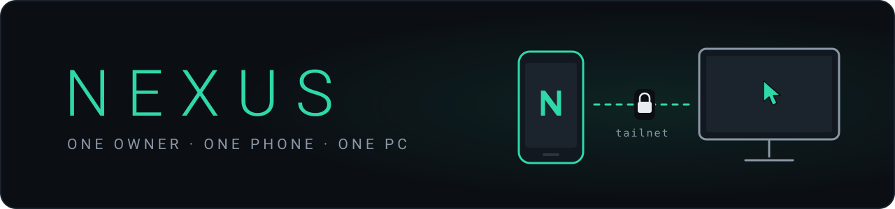
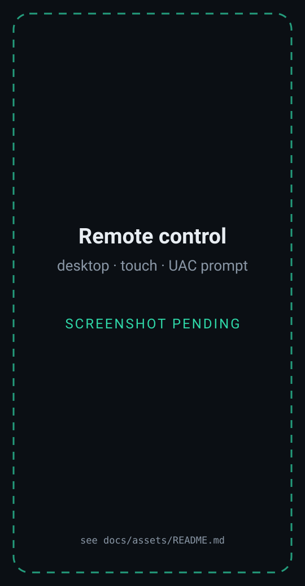
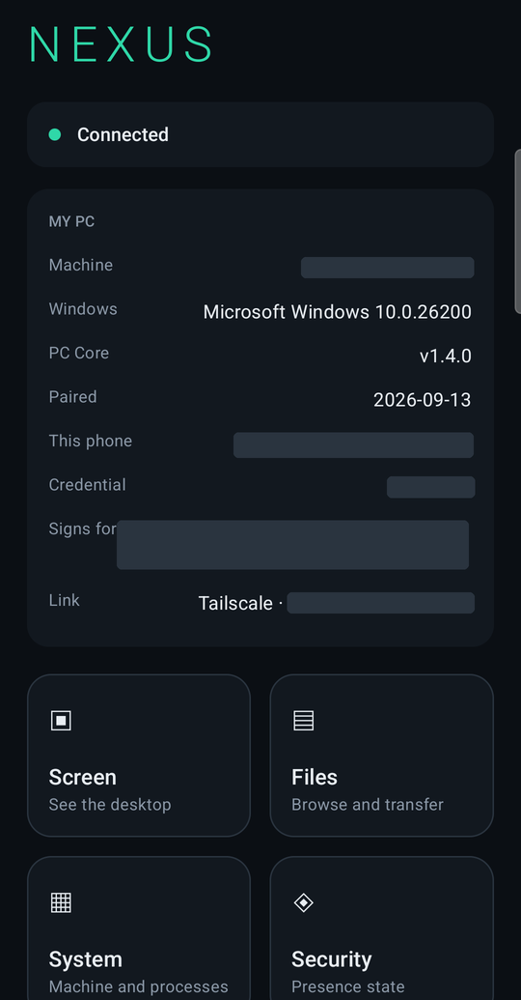
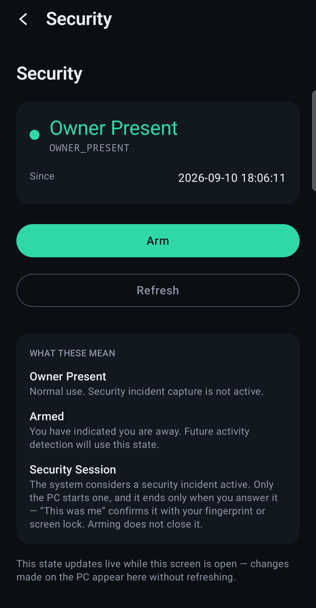
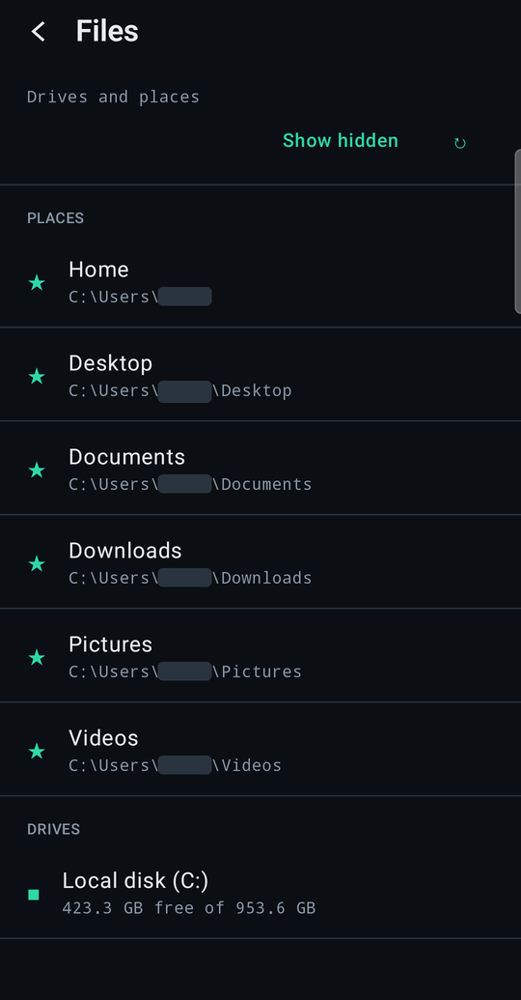
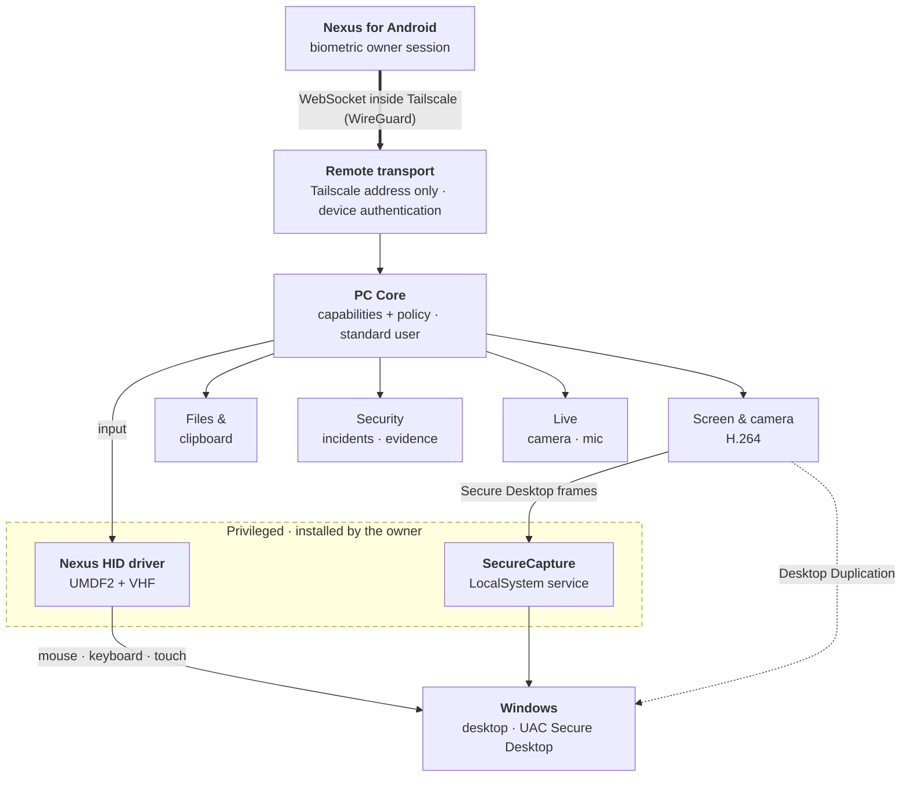

<p align="center">
  
</p>

<h1 align="center">Nexus</h1>

<p align="center">
  <b>A personal Android ↔ Windows remote-control and security system built for one owner and one PC.</b>
</p>

<p align="center">
  
  
  
  
</p>

Control your Windows PC from your phone through real virtual HID devices, all the way to the UAC
prompt, and find out when someone else uses it while you are away.

<table>
  <tr>
    <td width="25%" valign="top"><b>Virtual HID input</b><br>A Nexus mouse, keyboard and touch screen that Windows treats as hardware</td>
    <td width="25%" valign="top"><b>Low-latency desktop</b><br>H.264 with hardware encode and decode, measured latency, adaptive quality</td>
    <td width="25%" valign="top"><b>UAC from the phone</b><br>See and answer real consent prompts on the Secure Desktop</td>
    <td width="25%" valign="top"><b>Biometric owner sessions</b><br>Control requires Android's biometric prompt, verified by the PC</td>
  </tr>
  <tr>
    <td valign="top"><b>Security monitoring</b><br>Arm the PC; a stranger's input opens an incident with evidence</td>
    <td valign="top"><b>Live camera and mic</b><br>Watch the room, with a badge on the PC that cannot be hidden</td>
    <td valign="top"><b>Files and clipboard</b><br>Browse every drive, resumable hash-checked transfers, text both ways</td>
    <td valign="top"><b>Self-update</b><br>The PC updates itself with rollback; the phone pulls its APK from the PC</td>
  </tr>
</table>

<table>
  <tr>
    <td align="center" width="25%"><br><sub>Remote control <i>(capture pending)</i></sub></td>
    <td align="center" width="25%"><br><sub>Home</sub></td>
    <td align="center" width="25%"><br><sub>Security</sub></td>
    <td align="center" width="25%"><br><sub>Files</sub></td>
  </tr>
</table>

<sub>Real captures of Nexus 1.4.0 on the owner's phone. Identifiers are blanked out, not made up.</sub>

---

## Why Nexus exists

Remote-desktop products are built for everyone: help desks, fleets, strangers helping strangers. That
shapes every trade-off. They need accounts, relay servers, device lists and a security model that
assumes nothing about who is on either end.

Nexus is built for **one person controlling their own Windows PC from their own Android phone**, and
that assumption changes the design. There are no accounts and no relay, because both devices already
share a private Tailscale network. Pairing happens once, by scanning a QR code at the PC. Remote
control is unlocked through the phone's own biometric prompt rather than yet another password. And the integration can go
further than a general-purpose tool would: a signed input driver and a SYSTEM capture service only
make sense on a machine whose owner deliberately installed them.

Knowing exactly who the owner is also makes a second job possible. When the owner is away, the same
system watches the PC, and it can tell the owner's remote input apart from a stranger's hands on the
keyboard.

## What makes Nexus different

**Real input devices, not only `SendInput`.** A UMDF2 driver on Windows' Virtual HID Framework
publishes a Nexus mouse, keyboard and touch screen. Input arrives as device reports, so it reaches
elevated windows without an elevated helper process, and touch-aware apps get real touch. The driver
runs in user mode, so it needs no kernel-mode signing and Memory Integrity stays on.
→ [virtual-hid.md](docs/virtual-hid.md)

**It knows your input from a stranger's.** Every event is attributed to its source before it reaches
Windows: the Nexus devices are identified by their place in the PnP device tree and by Raw Input, not
by names a device could fake. You can work on an armed PC from your phone without setting off your
own alarm, while a person at the physical keyboard opens exactly one incident.

**The phone proves who is holding it.** Pairing proves *which* phone. Remote control also needs a
signature from a hardware-backed Keystore key that Android will only use right after its own
biometric or screen-lock prompt succeeds, and the PC verifies that signature. Enrolling a new
fingerprint destroys the key. Someone holding the phone who cannot pass that prompt gets a status
screen and nothing more.

**UAC stays on, and you can still answer it.** Most remote tools go blind at the Secure Desktop or
suggest turning UAC down. Nexus leaves it alone: a small LocalSystem service captures the prompt
inside the console session, HID reports deliver your taps, and authorisation is checked on every
frame. Nexus never approves anything itself.

**Devices that clean up after themselves.** The virtual devices exist only while PC Core holds the
driver handle. A crash or kill releases every held key, button and touch contact, and the devices
disappear. An explicit lifecycle with a neutral handshake, a failure budget and backoff keeps a
flaky driver from bouncing input between backends or leaving Ctrl stuck on a device nobody tracks.

**Streaming built around interframe video.** Dropping a queued H.264 frame corrupts every frame up
to the next keyframe, so Nexus never drops queued frames. It skips capturing instead. The phone
reports capture-to-render latency measured against a synchronised clock, bitrate changes apply to the
running encoder without a keyframe, and new resolutions are built beside the running encoder, not in
place of it.

**An incident lifecycle you can trust.** Nothing is recorded while you are present, and key codes
are never read. Evidence gets SHA-256 digests and retention rules. Deleting evidence or weakening
monitoring requires Windows Hello *at the PC*, so a stolen phone cannot erase the record of its own
theft.

**Updates without a server.** One script builds, signs, hashes and publishes a release on the PC. A
separate updater swaps only the files that changed and rolls back if the new build does not answer.
The phone downloads its APK from its own PC and checks the hash and signer before Android installs
it.

## Current capabilities

**Working.** In use on the owner's own PC and phone:

- Pairing by QR code over Tailscale, and biometric owner sessions
- Live desktop over H.264 with adaptive quality, pointer, keyboard and Direct touch
- Mouse, keyboard and touch through the Nexus virtual HID driver, including elevated windows
- Seeing and answering UAC prompts from the phone
- Arming the PC, incident detection and evidence recording, answering incidents from the phone
- Live camera view on the phone
- Tray icon, Start Menu entry, per-user install and auto-start
- PC self-update with rollback, and phone self-update from the PC

**Experimental.** Implemented and covered by tests, but not yet exercised end to end on the real
phone:

- File downloads and uploads (browsing is in use; transfers are verified on an emulator) and the
  clipboard
- Live microphone listening
- Playback of evidence camera clips and audio on the phone
- Background incident alerts while the app is closed

**Planned or not built yet:**

- Delete, rename and move in Files; folder downloads; image clipboard; transfers that continue in
  the background
- A virtual display for using the phone as a second monitor (researched, not started)

**Out of scope by design:** multiple users or devices, access from the internet or through a relay,
a stealth mode, and anything that disables or automates Windows security prompts.

## Architecture



**PC Core** is one standard-user process. Every request, from the phone or from the local control
panel, is a named capability checked against one policy. There is no shell, no process launch and no
arbitrary Windows call to reach.

**The privilege boundary is narrow and explicit.** Only two components run with more than user
rights, and the owner installs each one deliberately. The **HID driver** publishes three input
devices for the handle that created them and understands six fixed control operations. The
**SecureCapture** service accepts exactly one request, "start a capture worker in the console
session". Its worker connects back to a pipe PC Core named, proves a nonce, and returns pixels.
PC Core checks that the peer really is SYSTEM before asking for a frame. Neither component can run
commands or read files.

More: [security model](docs/security-model.md#privileged-components) ·
[remote control](docs/remote-control.md) · [development](docs/development.md#repository-layout)

## Security

Nexus can control a computer, so its security model is part of the product, not a footnote.

- **Your PC, your phone.** Exactly one paired phone, paired at the PC. The phone controls the PC, but
  it cannot pair another device, delete evidence or turn monitoring off.
- **Private network only.** The remote listener binds only to the PC's Tailscale address. Nothing
  listens on the LAN or the internet, and there is no relay, cloud service or account.
- **Two proofs, not one.** A 256-bit pairing credential proves *which phone* (HMAC
  challenge/response, never re-sent). A Keystore signature that Android releases only after its
  biometric or screen-lock prompt proves *who is holding it*, and that is required for full remote
  authority. Without it the phone sees a status screen.
- **Windows security stays switched on.** UAC, the Secure Desktop, Memory Integrity and driver
  signing are never changed. UAC prompts are real Windows prompts, answered by the owner.
- **Nothing is hidden.** A tray icon while PC Core runs, an on-screen badge while the phone controls
  the PC, and a `Camera LIVE` badge that no setting can hide. There is no stealth mode.
- **Evidence stays on the PC.** It is never uploaded, and deleting it requires Windows Hello at the
  machine.

Details: [docs/security-model.md](docs/security-model.md) · Reporting: [SECURITY.md](SECURITY.md)

## Getting started

You need Windows 10/11 with the .NET 10 SDK, an Android 12+ phone, and Tailscale signed in on both.

```bash
dotnet build PcCore.slnx -c Release
```

```bash
cd android/Nexus && ./gradlew :app:assembleDebug
```

Then install PC Core (`--install-app`), install the APK, and pair by scanning the QR code in the
local control panel. The optional driver and SecureCapture installs are described step by step in
**[docs/getting-started.md](docs/getting-started.md)**.

## Repository layout

```
src/            PC Core (C#): protocol, capabilities, Windows integration, transports, host,
                SecureCapture, updater, and the UMDF2 HID driver (src/driver, C)
android/Nexus/  the Android app (Kotlin, Jetpack Compose)
tests/          the .NET test suite
shared/         protocol vectors asserted by both the C# and Kotlin tests
tools/          release publishing, Android signing, driver validation and install
docs/           guides, research records, design history, assets
```

## Development

```bash
dotnet run --project tests/PcCore.Tests -c Release
```

```bash
cd android/Nexus && ./gradlew :app:testDebugUnitTest
```

Hardware self-tests (`PcCore.Host.exe --selftest-video`, `--selftest-security`, …), the phone
simulator, protocol vectors and the reasons `dotnet test` is not used are covered in
[docs/development.md](docs/development.md).

## Documentation

| | |
|---|---|
| [Getting started](docs/getting-started.md) | install, Tailscale, pairing, optional privileged parts, configuration |
| [Remote control](docs/remote-control.md) | gestures, the video pipeline, cursors, input paths, the Secure Desktop |
| [Security monitoring](docs/security-monitoring.md) | arming, detection, evidence, alerts, live sensors |
| [Files and clipboard](docs/files-and-clipboard.md) | browsing, transfers, clipboard |
| [Updating](docs/updating.md) | publishing, PC and phone updates, rollback |
| [Security model](docs/security-model.md) | network, pairing, owner sessions, policy, privileged components |
| [Virtual HID](docs/virtual-hid.md) · [Native input](docs/native-input.md) | the research records behind the input stack |
| [Release history](docs/history.md) | what each milestone added, and what real hardware found |

## License

No license has been chosen yet. Until one is added, all rights are reserved. Adapted third-party
source is recorded in [docs/third-party-notices.md](docs/third-party-notices.md).
