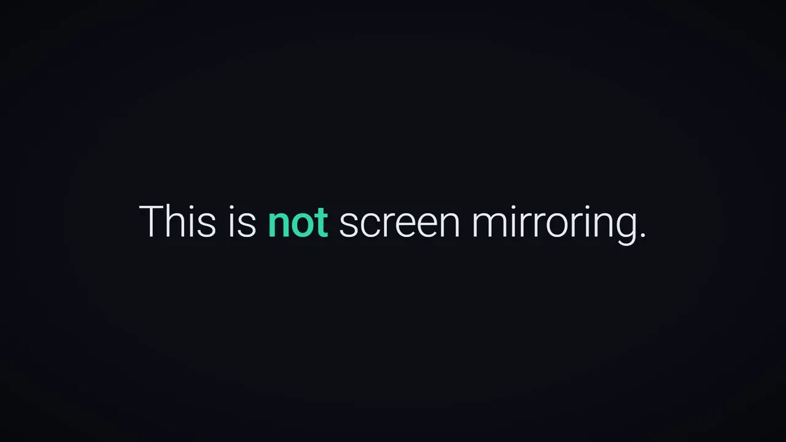
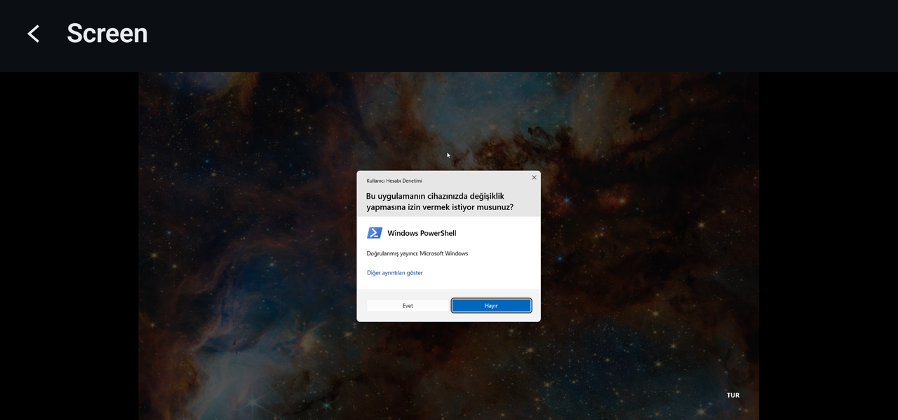
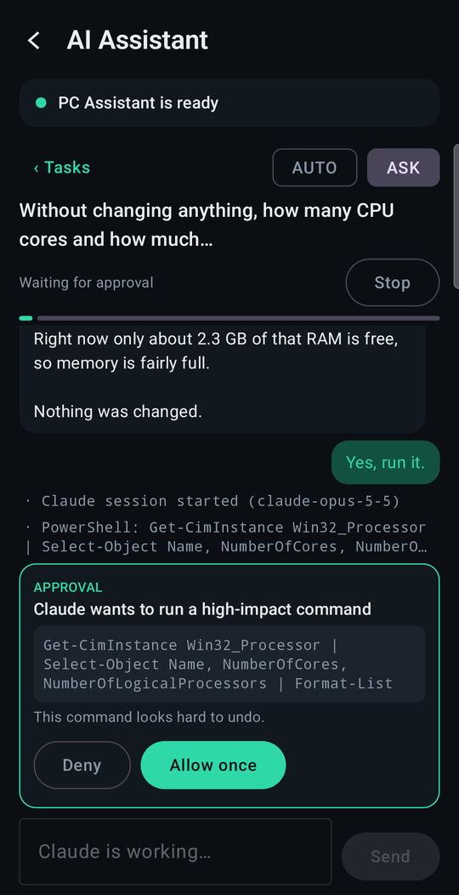
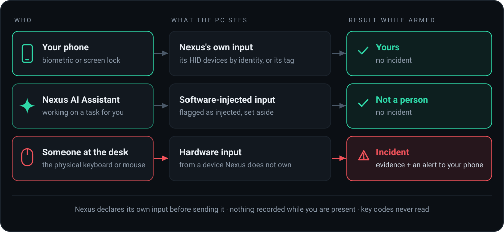

<p align="center">
  
</p>

<h1 align="center">Nexus</h1>

<p align="center">
  <b>Your Android phone as a real mouse, keyboard and touch screen for your own Windows PC.</b><br>
  Over your private Tailscale network, right through the UAC prompt. Nexus can also work on the PC
  for you, and it knows when the hands on your PC aren't yours.
</p>

<p align="center">
  <a href="docs/history.md"></a>
  <a href="#status"></a>
  <a href="#status"></a>
  <a href="LICENSE"></a>
</p>

<p align="center">
  <a href="#what-it-does-today">What it does</a> ·
  <a href="#who-is-at-the-keyboard">Security</a> ·
  <a href="#how-it-fits-together">How it works</a> ·
  <a href="#try-it">Try it</a> ·
  <a href="#documentation">Docs</a>
</p>

<p align="center">
  <picture>
    <source media="(prefers-reduced-motion: reduce)" srcset="docs/assets/nexus-launch-poster.jpg">
    
  </picture>
  <br>
  <sub>An animated demo that recreates the app's screens with their real strings. It is not a screen recording: <a href="#real-screens">real captures are below</a>.</sub>
</p>

## More than a remote screen

Remote-desktop tools are built for everyone: help desks, fleets, strangers helping strangers. Nexus
is built for **one owner, one Windows PC and one primary Android phone**, and that narrow scope is
what lets it go further on that one machine.

<table>
  <tr>
    <td width="33%" valign="top">
      <h3>You operate it</h3>
      The phone drives a Nexus mouse, keyboard and touch screen that Windows treats as hardware.
      With the optional driver, elevated windows respond too, and so does the UAC prompt, which you
      see and answer on the phone.<br><br>
      <a href="docs/remote-control.md">Remote control →</a>
    </td>
    <td width="33%" valign="top">
      <h3>It acts for you</h3>
      Give the Nexus AI Assistant on your PC a task from the phone and watch it work: the reply,
      each tool step, and the approval cards it asks you to answer. Administrator steps are approved
      by you, at the PC.<br><br>
      <a href="docs/ai-assistant.md">AI Assistant →</a>
    </td>
    <td width="33%" valign="top">
      <h3>It knows it isn't you</h3>
      Arm the PC and walk away. Your remote input and the Assistant's work are told apart from hands
      on the physical keyboard and mouse, and only a person at the desk opens an incident, with
      evidence and an alert on your phone.<br><br>
      <a href="docs/security-monitoring.md">Security monitoring →</a>
    </td>
  </tr>
</table>

## What it does today

| | |
|---|---|
| **Live desktop** | H.264 with hardware encode where available, hardware decode, adaptive quality and measured latency. Pointer, keyboard with latched modifiers, and Direct touch |
| **Real input devices** | A user-mode HID driver publishes the Nexus mouse, keyboard and touch screen. If PC Core stops, the devices disappear and every held key is released |
| **UAC from the phone** | See and answer real consent prompts on the Secure Desktop, with the optional driver and SecureCapture installed. UAC stays on, and Nexus never answers a prompt itself |
| **Owner sessions** | Pair once, by QR code at the PC. Control unlocks only after the phone's biometric or screen lock, proven to the PC with a hardware-backed key |
| **AI Assistant** | Start and follow up tasks, switch AUTO/ASK and answer approvals from the phone. It runs Claude Code under your own Claude account |
| **Security monitoring** | Arm the PC, detect a person, keep screenshot, camera and microphone evidence with SHA-256 digests, and answer *This was me* or *Not me* |
| **Live camera and mic** | Watch and listen to the room. The PC shows a `Camera LIVE` or `Microphone LIVE` badge that no setting can hide |
| **Files and clipboard** | Browse every drive; open, save and upload in resumable, hash-checked ranges; send text between the clipboards |
| **Self-update** | The PC updates itself and rolls back on failure. The phone downloads its APK from its own PC and checks the hash and signer |

Everything above is in use on the maintainer's own PC and phone, except for these, which are
implemented and tested but not yet exercised end to end on the real phone: file transfers (browsing
is in use), the clipboard, the live microphone, playback of evidence clips and audio, incident alerts
while the app is closed, and switching AUTO/ASK from the phone.

<a id="real-screens"></a>

<p align="center">
  
  <br>
  <sub>A UAC prompt on the Secure Desktop, on the phone</sub>
</p>

<table>
  <tr>
    <td align="center" width="33%"><br><sub>Home</sub></td>
    <td align="center" width="33%"><br><sub>AI Assistant</sub></td>
    <td align="center" width="33%"><br><sub>Security</sub></td>
  </tr>
</table>


## Who is at the keyboard

<p align="center">
  
</p>

Because Nexus knows exactly who the owner is, it can also notice who isn't. Nexus declares its own
input before Windows receives it, and recognises its virtual devices by their place in the device
tree, not by a name another device could copy. So you can work on an armed PC from your phone, the
Assistant can work on it for you, and neither raises anything. A person at the physical keyboard or
mouse opens exactly one incident. Nothing is recorded while you are present, and key codes are never
read.

The rest of the security model, briefly:

- **Two proofs, not one.** A 256-bit pairing credential proves *which phone* is calling. A Keystore
  signature that Android releases only after its biometric or screen-lock prompt proves *who is
  holding it*. Without that, the phone gets a status screen and nothing more.
- **Private network only.** PC Core's remote listener binds only to the PC's Tailscale address, so
  nothing listens on the LAN or the internet; the PC's own control panel is loopback-only, behind a
  token. Nexus has no server, relay or account of its own. Tailscale carries the connection,
  encrypted end to end, and may route it through its own relays when the two devices cannot reach
  each other directly.
- **Windows security stays on.** UAC, the Secure Desktop, Memory Integrity and driver signing are
  never changed. The driver runs in user mode, signed with a key your own PC creates for it.
- **The owner holds the dangerous switches, at the PC.** Pairing happens there. Deleting evidence
  or weakening monitoring needs Windows Hello there, so a stolen phone cannot use Nexus to erase the
  record of its own theft; the phone can disarm, with the owner's unlock, and recorded evidence
  stays. The Assistant's administrator steps are approved at the PC, never from the phone.
- **Nothing is hidden.** A tray icon while Nexus runs, a badge while the phone controls the PC
  (unless you choose tray-only, at the PC), and a `Camera LIVE` or `Microphone LIVE` badge that no
  setting hides. There is no stealth mode.
- **One part talks to a cloud service, and only if you set it up.** The Assistant runs Claude Code,
  so your instructions, and the screenshots and files it works with, go to Anthropic under your
  Claude account, and its tools can reach other sites when a task needs them. Everything else stays
  between your phone and your PC.

→ [Security model](docs/security-model.md) · [Reporting a vulnerability](SECURITY.md)

## How it fits together

<p align="center">
  
</p>

**PC Core** is one standard-user process. Every request, from the phone or the PC's own control
panel, is a named capability checked against one policy. There is no shell, no process launch and
no arbitrary Windows call to reach. **Everything that needs more than user rights is separate and
small, and the owner chooses it:** the HID driver and the SecureCapture service that makes the UAC
prompt visible, each installed deliberately; an optional input broker; one step of the updater,
behind its own UAC prompt; and the Assistant's helper, which you install once and which then carries
out the administrator steps you approve at the PC, without a further UAC prompt. **The AI Assistant
is its own process.** PC Core relays the owner's requests to it over a pipe that checks both
executables, and never runs anything itself.

Under the hood, for the technically curious:

- **A user-mode input driver.** UMDF2 on Windows' Virtual HID Framework, with no kernel-mode code of
  its own, so Memory Integrity stays on. → [virtual-hid.md](docs/virtual-hid.md)
- **Streaming built for interframe video.** A queued H.264 frame is never dropped, because that
  would corrupt every frame until the next keyframe; Nexus skips capturing instead. Bitrate changes
  apply to the running encoder. → [remote-control.md](docs/remote-control.md#the-video-stream)
- **Updates without a server.** One script builds, signs, hashes and publishes a release on the PC;
  the updater swaps only what changed and rolls back if the new build does not answer.
  → [updating.md](docs/updating.md)
- **One protocol, checked from both ends.** Shared protocol vectors are asserted by the C# and the
  Kotlin test suites. → [development.md](docs/development.md#protocol-vectors)

## Try it

Nexus publishes no binaries. You build it from this repository on your own PC, install it there,
and put the app on your own phone.

- **A PC** with Windows 11 x64 and the .NET SDK 10.0.400 or later
- **A phone** with Android 12 or later and a biometric or screen lock; building the app needs JDK 21
  and the Android SDK
- **Tailscale** signed in on both, in the same tailnet. That needs a Tailscale account; Nexus has
  none of its own
- *Optional:* for the HID driver, Visual Studio 2022 with the C++ workload (v143) and the Windows
  SDK and WDK 10.0.26100; for the AI Assistant, Claude Code with a Claude account

```powershell
dotnet build PcCore.slnx -c Release
# copies the build to %LOCALAPPDATA%\Programs\Nexus, per user, without administrator rights
src\PcCore.Host\bin\Release\net10.0-windows10.0.17763.0\PcCore.Host.exe --install-app
```

```powershell
cd android\Nexus
.\gradlew.bat :app:assembleDebug        # needs JAVA_HOME (JDK 21) and ANDROID_HOME
adb install -r app\build\outputs\apk\debug\app-debug.apk
```

Then start **Nexus** from the Start Menu, choose **Open Nexus** in its tray menu, click
**pairing.begin**, and scan the QR code with the app. The HID driver and SecureCapture, which bring
elevated windows and the UAC prompt within reach, are optional, deliberate installs. The AI
Assistant arrives with a Nexus release ([updating](docs/updating.md#publishing)) and stays off
until you set it up on both sides. **[Getting started](docs/getting-started.md)** walks through
every step, and how to remove all of it again.

## Status

**1.6.0 is the first public release** of a personal project with one maintainer. Nexus has grown
milestone by milestone since 0.1 ([release history](docs/history.md)) and is in use on the
maintainer's own PC and phone, but it has not been tested across a range of hardware, and it comes
without support.

| | Supported |
|---|---|
| **PC** | Windows 11, x64. The HID driver needs UMDF 2.33, which only Windows 11 has. PC Core alone targets Windows 10 1809 and later, but is not tested there |
| **Phone** | Android 12 and later |
| **Network** | Tailscale, on both devices |

**Not built yet:** delete, rename and move in Files; folder downloads; an image clipboard;
transfers that continue in the background; a virtual display for using the phone as a second
monitor.

**Out of scope by design:** more than one user, PC or phone; access from the internet or through a
relay of Nexus's own; a stealth mode; and anything that disables or automates Windows security
prompts.

## Documentation

| | |
|---|---|
| [Getting started](docs/getting-started.md) | build, install, Tailscale, pairing, the optional privileged parts, uninstalling |
| [Remote control](docs/remote-control.md) | gestures, the video pipeline, cursors, input paths, the Secure Desktop |
| [Security monitoring](docs/security-monitoring.md) | arming, detection, evidence, alerts, live camera and microphone |
| [Files and clipboard](docs/files-and-clipboard.md) | browsing, transfers, clipboard |
| [AI Assistant](docs/ai-assistant.md) | setting it up, using it from the phone, what leaves the PC, what the owner session guards |
| [Updating](docs/updating.md) | publishing a release, how the PC and the phone update, rollback |
| [Security model](docs/security-model.md) | network exposure, pairing, owner sessions, policy, privileged components, known limits |
| [Development](docs/development.md) | repository layout, building, tests, hardware self-tests, protocol vectors |
| [Virtual HID](docs/virtual-hid.md) · [Native input](docs/native-input.md) | the research records behind the input stack |
| [Release history](docs/history.md) | what each milestone added, and what real hardware found |

<details>
<summary><b>Repository layout and tests</b></summary>

```
src/            PC Core (C#): protocol, capabilities, Windows integration, transports, host,
                SecureCapture, updater, and the UMDF2 HID driver (src/driver, C)
src/Assistant/  the AI Assistant (C#, PcAssistant.*): its own solution and tests, and its own
                process, reached by PC Core over a local named pipe, never by reference
android/Nexus/  the Android app (Kotlin, Jetpack Compose)
tests/          the .NET test suite
shared/         protocol vectors asserted by both the C# and Kotlin tests
tools/          release publishing, Android signing, driver validation and the driver install plan
docs/           guides, research records, design history, assets
```

```powershell
dotnet run --project tests/PcCore.Tests -c Release
cd android\Nexus; .\gradlew.bat :app:testDebugUnitTest
```

Hardware self-tests, the phone simulator, and why `dotnet test` is not used for PC Core are covered
in [docs/development.md](docs/development.md).

</details>

## Reporting a vulnerability

Nexus can control a computer, read its files and turn on its camera, so please report a
vulnerability privately, not in a public issue. [SECURITY.md](SECURITY.md) explains how, and what is
in scope.

## License

Copyright 2026 melih3774. Licensed under the [Apache License, Version 2.0](LICENSE). Adapted
third-party source is recorded in [docs/third-party-notices.md](docs/third-party-notices.md).
