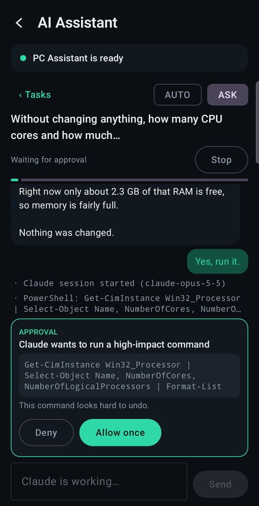
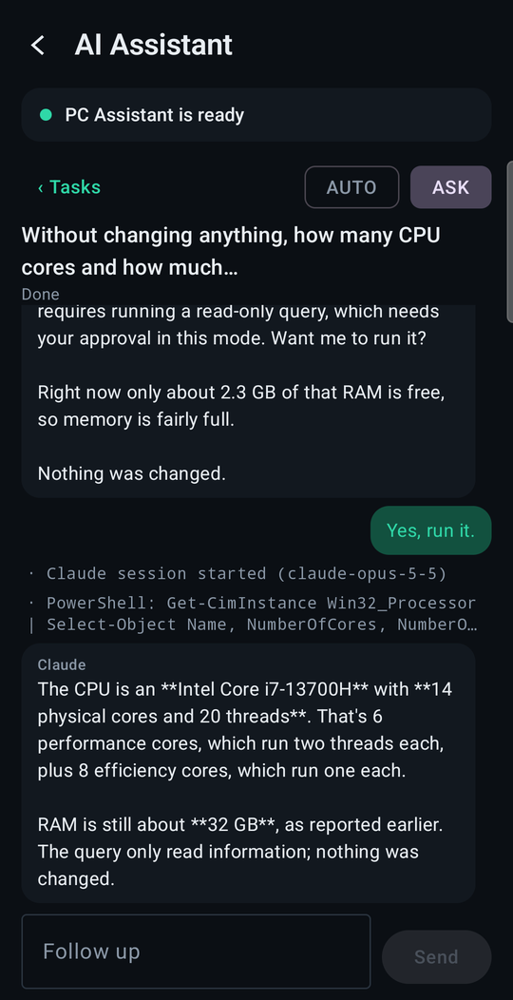

# AI Assistant

Ask the Assistant to do something on the PC, from the phone, and watch it work. The **Nexus AI
Assistant** is a Windows program of its own that runs Claude Code. Its source lives in this
repository, at [`src/Assistant/`](../src/Assistant/), under its original `PcAssistant.*` project and
namespace names; the executable is still `PcAssistant.Desktop.exe`.

**It is part of Nexus, and it is still a separate process.** PC Core does not reference its
assemblies, does not host it, and does not start it (an update that replaces it reopens it only if it
was already running). The two talk over the same local named pipe they
always have, and each verifies which executable is on the other end. Sharing a repository changed
where the code is kept and nothing about how the two programs meet.

A Nexus release builds it, and the Nexus updater installs it at
`%LOCALAPPDATA%\Programs\Nexus\Assistant\PcAssistant.Desktop.exe` and keeps it current. To replace it
the updater asks it to close, and it refuses while a task runs or an approval waits; see
[updating.md](updating.md#pc-assistant).

- [How it fits together](#how-it-fits-together)
- [What leaves the PC](#what-leaves-the-pc)
- [Setting it up](#setting-it-up)
- [Using it](#using-it)
- [What the phone shows](#what-the-phone-shows)
- [What the phone cannot do](#what-the-phone-cannot-do)
- [Security](#security)
- [The local protocol](#the-local-protocol)
- [Known limits](#known-limits)

---

## How it fits together

```
Nexus for Android ── Tailscale ──> PC Core ── owner-only named pipe ──> PC Assistant ──> Claude Code
   owner session                  assistant.*                           tasks, policy,
   and the screen                 capabilities                          approvals, tools
```

| | Owns |
|---|---|
| **PC Core and the app** | the phone link, pairing, the biometric owner session, who may use `assistant.*`, the Android screen |
| **The Assistant** | Claude Code and its sessions, AUTO/ASK, approval cards, task history, browser and PC tools |

The phone never talks to PC Assistant. PC Core never talks to Claude. A task started from the phone is an
ordinary PC Assistant task: it appears in PC Assistant's window, lives in its database, and can be
continued from either place.

## What leaves the PC

**This is the one part of Nexus that uses a cloud service.** The rest of Nexus stays between your
phone and your PC, over Tailscale, which may relay the encrypted connection when the two cannot
connect directly. PC Assistant runs Claude Code, signed in with your own Claude account, and
Claude Code sends Anthropic what the model needs to work: your instructions, the conversation, and
whatever its tools read for it, including screenshots of windows and the screen, text from
applications and the contents of files it opens. Anthropic's terms for your Claude account apply to
that data; Nexus adds no other recipient and no telemetry.

Nothing is sent until you set PC Assistant up and give it a task. Without it, Nexus has no
connection to anything but your phone.

## Setting it up

Both sides are off until you turn them on, and each has to be told which program to trust.

**1. PC Assistant.** In **Capabilities**, tick *Let Nexus on this PC use PC Assistant*. While it is
unticked there is no pipe at all.

**2. PC Core.** In `appsettings.Local.json` next to `PcCore.Host.exe` (an update never replaces that
file), enable the bridge and name the PC Assistant executable to trust:

```json
{
  "PcCore": {
    "Assistant": {
      "Enabled": true,
      "ServerExecutable": "C:\\Users\\<you>\\AppData\\Local\\Programs\\Nexus\\Assistant\\PcAssistant.Desktop.exe"
    }
  }
}
```

Restart PC Core.

**3. Trust PC Core in PC Assistant.** The first time PC Core connects, PC Assistant refuses it and
shows *Nexus at …\PcCore.Host.exe asked to connect* in **Capabilities**. Press **Trust this Nexus**.
The phone showed *PC Assistant and PC Core do not trust each other yet* until then, and shows *ready*
a few seconds after.

If PC Core moves, for example to a different build folder, both paths have to be updated. That is
deliberate: each side trusts one file.

### Moving from a development build

Installing PC Assistant does not change what anything trusts. A PC set up against a build folder
keeps trusting that folder until the owner says otherwise, and each refusal says why:

1. **Run one copy.** Close the development build before starting the installed one. Both use the same
   pipe name and the same database under `%LOCALAPPDATA%\PcAssistant`, and tasks, settings and the
   Claude Code sign-in carry over as they are.
2. **PC Core.** Change `ServerExecutable` in `appsettings.Local.json` to the installed path and restart
   PC Core. Until then PC Core refuses the installed copy and logs that the program serving the pipe
   is not the one it trusts.
3. **PC Assistant's trust in PC Core** does not change, because PC Core did not move.
4. **The administrator helper** serves only the executable it was installed from. The installed copy
   is told *This helper was installed for …* until the helper is reinstalled from it, in
   **Capabilities**, with one UAC prompt at the PC. Until then administrator approvals are refused,
   never bypassed.
5. **Start with Windows**, if it was on for the development build, shows as a stale entry in the
   installed copy; turn it on there.

## Using it

Open **AI Assistant** on the home screen.

- **Start a General task.** Choose **AUTO** or **ASK**, type what you want, press **Start**. Workspace
  tasks, which run inside a project folder, are created at the PC.
- **Open a recent task,** including one started at the PC or a Workspace task, and send follow-ups.
  A follow-up continues the same Claude session, so Claude remembers the conversation.
- **Watch it work.** The reply streams in. Tool steps appear as short lines between messages.
- **Answer approvals.** An approval card shows what Claude wants to do, the exact target, and why PC
  Assistant is asking. **Allow once** or **Deny**.
- **Switch AUTO/ASK** for an open task. The next tool call follows the new mode.
- **Stop** a task that is working. PC Assistant ends Claude's process tree.

<p align="center">
  
  &nbsp;
  
</p>

## What the phone shows

The status line at the top of the screen:

| Status | Meaning, and what to do |
|---|---|
| **Ready** | Tasks can be started and continued |
| **Claude is not ready on the PC** | Claude Code is not installed, not signed in, or signed in and refused by its account. The reason from PC Assistant is shown. Existing tasks can still be read |
| **PC Assistant is not running** | It is closed, its bridge is turned off, or another program is connected to it. Nexus never starts PC Assistant |
| **… do not trust each other yet** | Step 3 above, or `ServerExecutable` does not match the running PC Assistant |
| **… versions do not match** | Update whichever of Nexus and PC Assistant is older |
| **The PC Assistant bridge is off** / **not set up in PC Core** | Step 2 above |

While the phone has the screen open, PC Core keeps the connection to PC Assistant and checks for it
every five seconds, so PC Assistant opening or closing appears without a refresh.

## What the phone cannot do

These are deliberate in this version:

- **Administrator approvals** are shown, and answered only at the PC in PC Assistant's own card.
- **Allow for this task** does not exist on the phone. Every answer is one approval.
- No Workspace task creation, no voice, no image input.
- No approval notifications while the app is closed. The screen has to be open.
- Nexus does not launch PC Assistant.

## Security

**PC Core still has no remote shell.** No `assistant.*` action names a command, a program or a process.
But be clear about what this feature is: **an owner who has authenticated on the phone can now
instruct PC Assistant, and PC Assistant can run commands and use tools on the PC** under its own AUTO/ASK
policy and approval cards. In AUTO, routine work proceeds without asking. PC Assistant's policy, not
Nexus's, decides what that includes.

What Nexus enforces:

- **Every `assistant.*` action needs the Full Remote owner session.** A paired phone whose owner has not
  authenticated is refused before PC Assistant is contacted. `ActorType.Ai` still reaches nothing.
- **A transcript reaches only the connection that asked for it, while it holds the owner session.**
  `assistant.*` events are delivered to a connection that called `assistant.subscribe` and, at the
  moment each event is sent, still holds Full Remote. A connection found without it loses the
  subscription. Locking the phone, the session lapsing, or reconnecting all mean asking again. Pushed
  events do not count as activity, so a long reply cannot keep an idle session open.
- **The phone forgets what it was shown** when Nexus locks. The task list and transcript are dropped
  from memory, not just hidden behind the lock screen.
- **The pipe is checked before anything is sent.** It must belong to the current user, be served from
  this Windows session, and be served by exactly the configured `ServerExecutable`. A program that
  created the pipe name first would otherwise receive the owner's prompts.
- **Input is checked before it is relayed.** Ids must be ids, modes `auto` or `ask`, answers `allow_once`
  or `deny`, prompts at most 32,000 characters. PC Assistant's replies are re-serialised into named
  fields, so a field PC Assistant adds later does not reach the phone until Nexus names it.

What PC Assistant enforces, separately: its pipe admits only the owner and refuses network logons; the
connecting process must be in the same session, run as the same user, and be the one PC Core
executable the owner trusted; administrator approvals cannot be answered through the bridge.

**Security monitoring.** An ARMED PC does not raise an incident for PC Assistant's own clicks and typing.
Every event PC Assistant injects carries Windows' injected flag, and the detector already sets aside
injected input that is not Nexus's own. Measured twice on the development PC. First with the real
detector and an ARMED monitor in a throwaway state directory, while PC Assistant's real input path
clicked, pressed keys and typed text into test windows: 32 keyboard and 8 pointer events, all read as
synthetic, and 0 incidents. Then on the real PC Core, actually `ARMED`, while a task asked for through
`assistant.*` clicked a window, typed into it and pressed a key: still `ARMED` afterwards, with no new
security session. The windows PC Assistant brought forward appear as foreground changes, which enrich an
incident's timeline but never start one. Nexus's monitoring was not changed for this feature.

## The local protocol

PC Core and PC Assistant speak one JSON object per line over the pipe
`\\.\pipe\PcAssistant.NexusBridge.<user SID>`. The protocol belongs to PC Assistant and is documented
there. PC Core's side:

| PC Core action | PC Assistant method | Needs Claude ready |
|---|---|---|
| `assistant.status` | `hello` on connect, then `status` | no |
| `assistant.tasks.list` | `tasks.list` | no |
| `assistant.tasks.get` | `tasks.get` | no |
| `assistant.tasks.create` | `tasks.create` (General only) | yes |
| `assistant.tasks.send` | `tasks.send` | yes |
| `assistant.tasks.stop` | `tasks.stop` | no |
| `assistant.tasks.set_mode` | `tasks.set_mode` | no |
| `assistant.approvals.resolve` | `approvals.resolve` | no |

| PC Assistant event | Phone event |
|---|---|
| `task.changed` | `assistant.task_changed` |
| `message.appended` | `assistant.message`, a growing snapshot of one message, at most every 250 ms |
| `task.progress` | `assistant.progress` |
| `approval.requested` | `assistant.approval_requested` |
| `approval.resolved` | `assistant.approval_resolved` |
| the connection closing or returning | `assistant.status_changed` |

Refusals: `assistant_unavailable` (with the status state in `details`), `assistant_task_busy`,
`assistant_requires_local_approval`, and the ordinary `not_found`, `invalid_parameters`, `unsupported`.
All of these shapes are pinned in `shared/protocol/protocol-vectors.json`.

## Known limits

- **Foreground on the PC.** An action approved from the phone has no click at the PC behind it, so PC
  Assistant brings its target window forward on its own. That works with an ordinary application in
  front. It did not work while the Quick Settings flyout held the foreground: PC Assistant stops and says
  which window needs to be in front. A locked PC, or a UAC prompt, stops desktop actions entirely.
- **Streaming is snapshots.** A long reply is resent in full every 250 ms while it grows. On a slow link
  that is more traffic than deltas would be.
- **A big answer can be slow to start.** Short replies appear within a few seconds and grow a couple of
  characters at a time. Asking for something long — a few hundred lines — was observed to show nothing
  but *Working* for the best part of a minute before the first text arrived, because that is when Claude
  Code emits it. Nothing is lost; there is just no progress to show in between.
- **One PC Core at a time.** PC Assistant serves one connection, so a second PC Core (a development build
  alongside the installed one, say) is reported as *not running*.
