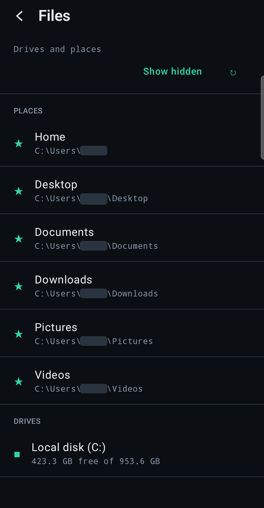

# Files and clipboard

Since v1.4, the **Files** card browses the PC itself: every local fixed or removable drive, with
Home, Desktop, Documents, Downloads, Pictures and Videos as shortcuts. Tap a folder to open it, **Up**
to go back out, and **Show hidden** for AppData and similar folders. Each file shows its type, size
and modification time, and offers three actions:

- **Open** downloads it into the app's cache and hands it to whichever Android app opens that type.
- **Save to phone** downloads it into `Download/Nexus` through MediaStore, with no storage permission
  needed.
- **Upload here** opens the system picker for one or more files, uploaded into the folder on screen.

Transfers run two at a time, with progress and **Cancel**, and keep going when you leave Files.

  

## The actions

| Action | What it does |
|---|---|
| `files.roots` | drives (label, free space) and the usual places inside the boundary |
| `files.list` | one folder's entries, plus `parent` and `truncated` (a listing stops at 5,000 entries) |
| `files.stat` | metadata for one file or folder |
| `files.read` | one range, default 1 MB, max 4 MB, with `expected_size_bytes` / `expected_modified_utc` |
| `files.hash` | SHA-256 of the file as it is on disk right now |
| `files.upload.begin` / `.chunk` / `.finish` / `.cancel` | an upload into a folder, in ranges of at most 1 MB, strictly in order |
| `clipboard.get` / `clipboard.set` | text only, up to 262,144 characters |

## Who may

Every one of these actions is available to the phone, and none is in the small set allowed before
the owner has unlocked Nexus. A paired phone whose owner has not unlocked the app gets
`not_authorized`, and so does a session the phone has locked mid-transfer. There is no HTTP endpoint
for any of it: it runs over the same authenticated WebSocket and the same dispatcher as everything
else. The remote transport accepts messages up to 2 MB once a device has authenticated (a 1 MB upload
chunk is 1.4 MB as base64). Before authentication the limit is 64 KB.

## Windows still decides

PC Core runs as you and never elevated. A folder you cannot open in Explorer is `access_denied` here
too, a file another program has locked is `file_in_use`, and a full disk is `disk_full`, reported at
the *start* of an upload because the space is reserved up front.

The filesystem boundary works the same way it always has; `{Drives}` is simply the default root now.
Every path is checked by shape, resolved to its real path by the kernel, and compared segment by
segment ([security-model.md](security-model.md#the-filesystem-boundary)). Nexus's own folders
(`%LOCALAPPDATA%\Nexus`, the install folder, `%ProgramFiles%\Nexus`) are refused whatever the roots
say, so Files cannot become a way around the rules that protect evidence and owner keys.

## Downloads

Downloads are stateless ranged reads. Each range names the size and modification time the download
started from, so a file that changes mid-download comes back as `file_changed` rather than two
versions stitched together. At the end, the phone hashes what it received and compares it with
`files.hash`. Only a match is kept.

## Uploads

An upload goes into a hidden `name.<id>.nexus-upload` file beside the destination, so the new file
inherits that folder's permissions like anything else saved there. It is renamed over the real name
only once the whole file has arrived and matches the SHA-256 the phone sent. A name that already
exists returns `already_exists`, and the phone asks before replacing it. Replacing is the only change
Files can make to an existing file. There is no delete, rename or move.

## When the link drops

A transfer stops in a *Resume* state, never as a frozen progress bar. A download keeps its partial
file on the phone. An upload's partial file stays on the PC, owned by the device rather than the
socket, and starting the same upload again reports how much already arrived. When the owner session
comes back, interrupted transfers resume once on their own.

Cleanup on the PC:

- an upload that receives nothing for `PcCore:Files:UploadIdleMinutes` (10) is deleted
- PC Core stopping deletes all partial uploads
- a small journal (`uploads.json`) deletes whatever a crash left behind, at the next start

## Clipboard

Two buttons on the home screen: **Copy from PC**, and **Send to PC**, which opens with the phone's
clipboard pre-filled so you can send it as-is or edit it first. There is no automatic sync.

Echoes cannot loop. Setting text the PC already holds is `changed: false` and does not count as a new
version. `clipboard.get` reports `origin: "phone"` while the PC still holds what the phone sent, and
the phone does not rewrite its own clipboard with text it knows is already there. Only hashes are
remembered, in memory, on both ends.

## Not in this version

- folder downloads
- image or file clipboard formats
- transfers that continue after Nexus leaves the screen (the connection closes then; transfers
  resume when it comes back)
- drives attached after PC Core started (restart PC Core)
- delete, rename and move
