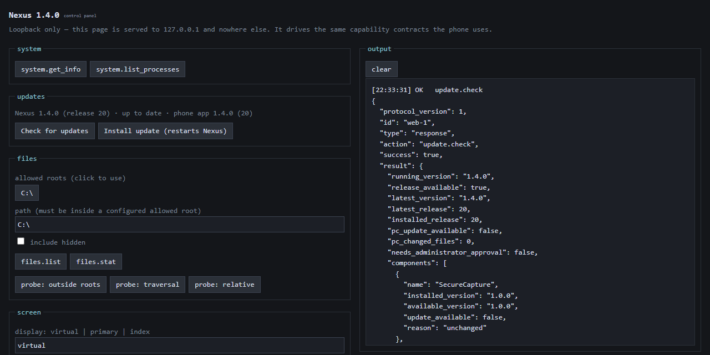

# Getting started

Nexus is a personal system: one owner, one Windows PC, one Android phone. Nothing here is published
to a store or a download page. You build it, install it on your own PC, and put the app on your own
phone.

- [Requirements](#requirements)
- [1. Build and install PC Core](#1-build-and-install-pc-core)
- [2. Tailscale on both devices](#2-tailscale-on-both-devices)
- [3. Install the phone app](#3-install-the-phone-app)
- [4. Pair](#4-pair)
- [5. Optional: the privileged parts](#5-optional-the-privileged-parts)
- [Starting at sign-in](#starting-at-sign-in)
- [Where things live](#where-things-live)
- [Configuration](#configuration)
- [When the phone cannot connect](#when-the-phone-cannot-connect)
- [Uninstalling](#uninstalling)

---

## Requirements

| | |
|---|---|
| **PC** | Windows 11, x64, and the .NET SDK 10.0.400 or later. The HID driver needs Windows 11: it is built on UMDF 2.33, which Windows 10 does not have. PC Core without the driver targets Windows 10 1809 and later but is not tested there |
| **Phone** | Android 12 or later, with a biometric or screen lock |
| **Network** | [Tailscale](https://tailscale.com) signed in on both devices, same tailnet. That needs a Tailscale account; Nexus has no account of its own |
| **Android builds** | JDK 21 and the Android SDK (Gradle wrapper included), found through `JAVA_HOME` and `ANDROID_HOME` ([details](#3-install-the-phone-app)) |
| **Driver builds and installs** | Visual Studio 2022 (Build Tools or any edition) with the *Desktop development with C++* workload (MSVC v143), and the Windows SDK and WDK **10.0.26100**. The project pins both; a newer Visual Studio alone does not build it. Installing needs the WDK too, for `devgen` and `signtool` |

Nexus publishes no prebuilt binaries: everything here is built on your own PC from this repository.
PC Core itself needs **no administrator rights** and logs a warning if it is started elevated.

## 1. Build and install PC Core

```bash
dotnet build PcCore.slnx -c Release
```

```bash
src/PcCore.Host/bin/Release/net10.0-windows10.0.17763.0/PcCore.Host.exe --install-app
```

`--install-app` copies the build to `%LOCALAPPDATA%\Programs\Nexus`, adds a Start Menu entry, and
points auto-start at the installed copy rather than at `bin\Release`, a folder that any rebuild or
branch switch can empty. Everything stays per-user: no elevation, no service, no `Program Files`.
`--shell-status` reports what is installed where.

After that, **Nexus** in the Start Menu starts PC Core with a tray icon. **Open Nexus** in the tray
menu opens the local control panel.

<p align="center">
  
</p>

Once installed, later builds are best delivered with `tools/publish-release.ps1 -Install`, which
updates in place and rolls back on failure. See [updating.md](updating.md).

## 2. Tailscale on both devices

Install Tailscale on the PC and on the phone, and sign both into the same tailnet. **Nexus never
touches your Tailscale account and cannot set it up for you.**

PC Core logs the Tailscale address it bound to, or explains why it bound nothing. If Tailscale is not
running there is simply no remote listener. It starts on its own once a Tailscale address appears,
with no restart needed, and stops if the interface goes away.

## 3. Install the phone app

For a first install, build a debug APK and install it over USB. Gradle needs to find a JDK 21 and
the Android SDK. With Android Studio installed, its bundled JDK and SDK work (adjust the paths if you
installed them elsewhere), in PowerShell:

```powershell
$env:JAVA_HOME = "$env:ProgramFiles\Android\Android Studio\jbr"
$env:ANDROID_HOME = "$env:LOCALAPPDATA\Android\Sdk"
```

Instead of `ANDROID_HOME`, an `android/Nexus/local.properties` with `sdk.dir=` and the SDK path also
works; it is machine-specific and never committed. Then:

```powershell
cd android/Nexus
.\gradlew.bat :app:assembleDebug
```

```powershell
adb install -r app/build/outputs/apk/debug/app-debug.apk
```

For updates that keep pairing intact, set up the stable release signing key once and let the phone
update itself from the PC ([updating.md](updating.md#one-time-setup)).

## 4. Pair

1. Open the control panel on the PC and click **pairing.begin**. A QR code appears, together with the
   same code as text. It expires in five minutes and works exactly once.
2. Open Nexus on the phone and tap **Scan QR**, or **Paste pairing code**. The camera permission is
   requested at that moment, never at launch.
3. The phone proves it holds the pairing secret, receives its permanent credential, and reconnects
   as the Primary Phone.
4. Unlock Nexus with your fingerprint or screen lock. That unlock is what gives the phone remote
   control, files and evidence ([security-model.md](security-model.md#owner-authentication)).

If the PC has no Tailscale address when you start pairing, the control panel says so, and so does
the phone, instead of failing vaguely.

## 5. Optional: the privileged parts

Everything above works without administrator rights. Two optional components add reach to remote
control, and each is installed deliberately, once, from an elevated terminal.

**The Nexus HID driver** (mouse, keyboard and touch as real devices, and the only path that reaches
the UAC prompt):

```bash
powershell -ExecutionPolicy Bypass -File tools/validate-driver-package.ps1
```

```bash
powershell -ExecutionPolicy Bypass -File tools/nexus-hid-install.ps1 -Action Install
```

The first script builds and stages the package in `artifacts\NexusHidPackage` without installing
anything. The second changes nothing either: it reads this PC (security posture, the package, the WDK
tools, what is installed) and prints the exact install plan for it, every command with its full tool
path. Run those commands in one elevated PowerShell, in order, checking each result:

1. create the signing key, or reuse the one this PC already has;
2. sign the package's catalog with it;
3. trust that one certificate in `LocalMachine\Root` and `LocalMachine\TrustedPublisher`;
4. check the signature is `Valid`;
5. create the root device with `devgen`;
6. install the package with `pnputil`;
7. if 6 fails, remove the device before retrying;
8. compare the security posture with the baseline;
9. check the driver is running.

**The signing key is yours.** Nexus publishes no signed driver. Each PC creates its own key
(`CN=Nexus Driver Signing`, code signing only, private key not exportable, in your personal
certificate store) and trusts it on that PC only. From then on this PC accepts code and driver
packages signed by that key, which is why the key never leaves it. A release you publish later on
the same PC carries the package as you signed it; a rebuilt driver has to be signed again with the
same key (step 2) before a release includes it ([updating.md](updating.md)). The uninstall plan
below removes the trust. The script refuses to plan an install under test signing or over an
existing Nexus device, and nothing in it changes Secure Boot, Memory Integrity, test signing or UAC.

**SecureCapture** (lets the phone see UAC prompts and the lock screen), from an elevated terminal.
It copies itself to `%ProgramFiles%\Nexus\SecureCapture` and registers the `NexusSecureCapture`
service:

```powershell
src\PcCore.SecureCapture\bin\Release\net10.0-windows10.0.17763.0\PcCore.SecureCapture.exe --install
```

A machine with neither still gets remote control, through injection, of everything except elevated
windows and the Secure Desktop. The elevated input broker (`--install-native-input`) is a middle
option. See [remote-control.md](remote-control.md#how-input-reaches-windows).

The driver, SecureCapture and the input broker are three of Nexus's five privileged parts. The other two are the updater's one elevated step
and PC Assistant's privileged helper, which you install from PC Assistant if you want it
([security-model.md](security-model.md#privileged-components)).

## Starting at sign-in

PC Core registers itself with one per-user value:

```
HKCU\Software\Microsoft\Windows\CurrentVersion\Run
  PcCore = "<full path to PcCore.Host.exe>"
```

No service, no scheduled task, no watchdog. It appears in Task Manager's **Startup apps**, where you
can disable it. `--startup-status`, `--install-startup` and `--uninstall-startup` manage it by hand.
To stop PC Core registering itself while you debug, set `PcCore:Startup:Enabled` to `false`.

## Where things live

Everything that survives a restart is under `%LOCALAPPDATA%\Nexus`, never in the repository:

| Path | Contents |
|---|---|
| `instance.json` | a random installation id, not derived from any hardware or user identifier |
| `security-state.json` | security state, previous state, timestamp, revision |
| `primary-phone.json` | device id, display name, pairing time, and the shared secret as a DPAPI blob |
| `Security\` | incidents and evidence |
| `Releases\` | published releases, for updates |
| `update\` | the updater's status, log and records of what is installed |
| `pccore.log` | PC Core's log (one previous generation kept; **Open log** in the tray) |

Writes are atomic (temporary file, flush, atomic replace). A corrupt file is renamed aside, never
deleted.

Elsewhere on the PC:

| Path | Contents |
|---|---|
| `%LOCALAPPDATA%\Programs\Nexus` | the installed PC Core, and PC Assistant under `Assistant\` once a release installed it |
| `%LOCALAPPDATA%\PcCore` | the local control panel's session token |
| `%LOCALAPPDATA%\PcAssistant` | PC Assistant's own tasks, settings and logs, if you use it |
| `%ProgramFiles%\Nexus` | SecureCapture, and the elevated updater's log under `Updates\` |
| Driver Store, `LocalMachine\Root` and `TrustedPublisher`, `CurrentUser\My` | the HID driver package, the trusted signing certificate and its key |

## Configuration

`appsettings.json` beside `PcCore.Host.exe`, overridable with `PCCORE_`-prefixed environment
variables, or with an `appsettings.Local.json` next to it that updates never overwrite. Every section
in the shipped file has a comment explaining it. The main ones:

| Section | What it controls |
|---|---|
| `Files` | `AllowedRoots` (tokens `{Drives}` `{Desktop}` `{Documents}` `{Downloads}` `{Pictures}` `{Music}` `{Videos}` `{UserProfile}`, or absolute paths), `UploadIdleMinutes` |
| `RemoteTransport` | `Enabled`, `Port` (47812), session limits. **The bind address is not configurable** |
| `Security` | detection thresholds, evidence intervals, retention |
| `Input` | rate limits and size caps for remote input |
| `Stream` | backlog limits and the JPEG fallback; H.264 quality is chosen from the phone |
| `Pairing` | pairing session and challenge lifetimes |
| `Startup` | whether PC Core registers itself for sign-in |

A root that cannot be resolved is logged and dropped, never quietly widened.

## When the phone cannot connect

The phone says which of these it is:

- **No network**: the phone has no connection at all.
- **Tailscale not connected**: the phone has no tailnet address of its own.
- **PC unreachable**: the phone is on the tailnet and the PC did not answer.
- **Authentication failed**: the PC rejected the credential. The phone stops retrying until you
  press Retry, and both ends show the device id, installation id and credential fingerprint so you
  can compare them before re-pairing.

PC Core's log names the reason for a refused phone, using identifiers only.

## Uninstalling

Nexus has no single uninstaller, because each part was installed deliberately and is removed the same
way. Go in this order, so each command still finds the program it runs. Skip any part you never
installed.

1. **Exit Nexus** from its tray icon. If you use PC Assistant: remove its privileged helper if you
   installed it (**Capabilities → Uninstall Privileged Helper**), turn off its *Start with Windows*
   setting if you turned it on, then close PC Assistant.
2. **The HID driver.** Print the plan, then run its commands from an elevated PowerShell. It removes
   the device, every Nexus driver package and the trust in the signing certificate; with
   `-RemoveSigningKey` it deletes the key as well.

   ```powershell
   powershell -ExecutionPolicy Bypass -File tools/nexus-hid-install.ps1 -Action Uninstall -RemoveSigningKey
   ```

3. **SecureCapture**, from an elevated terminal. It stops and deletes the service, and the folder can
   go afterwards:

   ```powershell
   & "$env:ProgramFiles\Nexus\SecureCapture\PcCore.SecureCapture.exe" --uninstall
   Remove-Item -Recurse "$env:ProgramFiles\Nexus"
   ```

4. **The input broker**, if you installed it, from an elevated terminal:

   ```powershell
   & "$env:LOCALAPPDATA\Programs\Nexus\PcCore.Host.exe" --uninstall-native-input
   ```

5. **PC Core.** `--uninstall-app` removes the Start Menu entry and the start at sign-in; the folder
   (with PC Assistant inside it, if a release installed it) is deleted by hand:

   ```powershell
   & "$env:LOCALAPPDATA\Programs\Nexus\PcCore.Host.exe" --uninstall-app
   Remove-Item -Recurse "$env:LOCALAPPDATA\Programs\Nexus"
   ```

6. **Your data**, last, and only if you mean it: this deletes the pairing, the security history and
   all evidence, and cannot be undone.

   ```powershell
   Remove-Item -Recurse "$env:LOCALAPPDATA\Nexus", "$env:LOCALAPPDATA\PcCore"
   Remove-Item -Recurse "$env:LOCALAPPDATA\PcAssistant"   # only if you used PC Assistant
   ```

   If you set up release signing ([updating.md](updating.md#one-time-setup)), its key is in
   `%USERPROFILE%\.nexus`; delete that folder too. Back it up first if you may build Nexus for the
   same phone again: without that key, a new build cannot update the app already installed.

7. **The phone:** uninstall the Nexus app. Tailscale is yours, and Nexus never changed it.

Nothing else is left: apart from what these steps remove, Nexus adds no service, scheduled task,
firewall rule or registry value.
