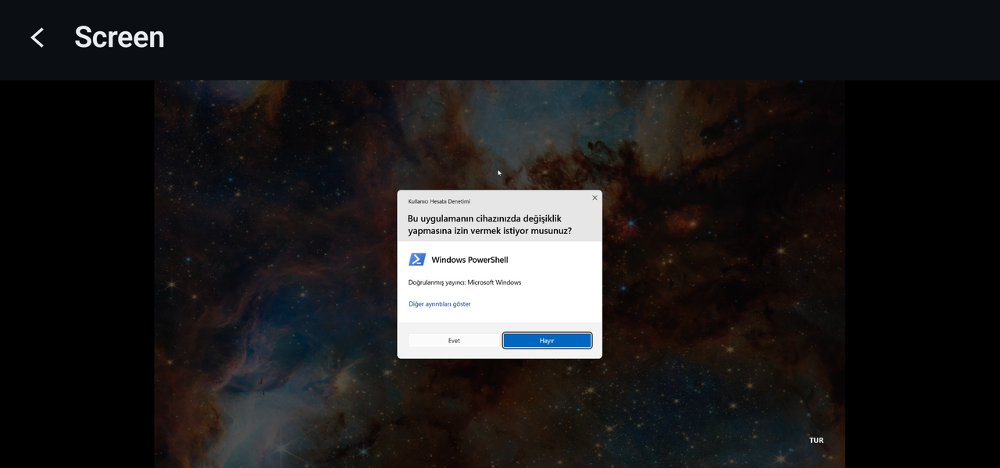
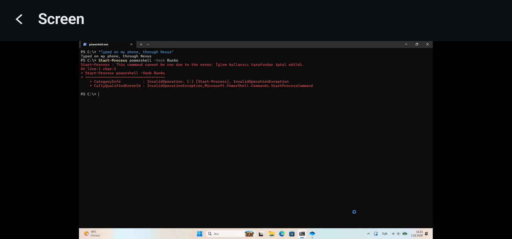

# Remote control

The **Screen** card on the phone is the PC's desktop, live, with pointer, keyboard and touch. This
guide covers how it behaves, how the picture gets to the phone, how input gets into Windows, and what
happens at a UAC prompt.

- [Using it](#using-it)
- [What the PC shows while it happens](#what-the-pc-shows-while-it-happens)
- [The video stream](#the-video-stream)
- [The cursor](#the-cursor)
- [How input reaches Windows](#how-input-reaches-windows)
- [The Secure Desktop](#the-secure-desktop)
- [Checking it without a phone](#checking-it-without-a-phone)

Remote control needs an owner-authenticated session. See [security-model.md](security-model.md).

---

## Using it

```
┌─────────────────────────┐
│                         │   move            → move the pointer
│      PC SCREEN          │   tap             → left click
│                         │   hold, then move → drag
│                         │   hold, then lift → right click
├─────────────────────────┤   two fingers     → scroll
│ Direct | Touchpad       │
│ Control             [•] │
│ Left Double Right Middle│
│ Type on the PC…         │
└─────────────────────────┘
```

**Moving the pointer never presses anything.** Holding still for a moment is what asks for a button,
and what you do next decides which one: move and it is a drag, lift and it is a right click. Anything
else has a button on the toolbar. The recogniser is plain Kotlin with no Android types in it
(`PointerGestureRecognizer`), because the bug it replaced was a logic bug a test should have caught.

**Watching is not controlling.** Opening the screen starts the stream. The `Control` switch is what
lets the phone move the pointer and type. Leaving the screen, backgrounding the app or losing the
connection turns control off again and releases anything still held, like a button mid-drag or a
latched Ctrl. Neither side trusts the other to have cleaned up.

**Direct** puts the pointer where your finger is and carries it as touch, so touch-aware
applications get real touch. **Touchpad** moves the pointer by how far your finger moved, which is
easier for precise work when a fingertip covers forty pixels of desktop.

**Modifiers latch**, because you cannot hold Ctrl and tap C at the same time on a touchscreen. Tap
`Ctrl`, it lights up, and the next key or click is wrapped in it, so Ctrl+C, Alt+Tab and Win+R all
work. The action it modified uses the latch up.

**Typing** goes through a text field and is sent as Unicode, so a keyboard in any language produces
the right characters. The buttons beside it cover keys text cannot express: Esc, Tab, Enter,
Backspace, Delete, Home, End, Page Up/Down and the arrows.

## What the PC shows while it happens

Always something. The three modes change how much it gets in the way, never whether it exists:

| Mode | Input live | Watching only |
|---|---|---|
| `STANDARD` (default) | badge + tray | tray |
| `MINIMAL` | tray | tray |
| `ALWAYS_VISIBLE` | badge + tray | badge + tray |

The badge is a small translucent pill in a corner of the screen. It lets clicks through and never
takes focus. The mode is chosen on the PC's local control panel. It is a decision about this PC, made
at this PC, and the phone deliberately cannot change it. Live camera and microphone have their own
badge, and no mode can hide it (see [security-monitoring.md](security-monitoring.md#live-camera-and-microphone)).

## The video stream

Screen frames started out as independent JPEGs. That kept the protocol simple, but the desktop looked
soft and the camera ran at about one frame a second. Since v1.2 both go through a real video
pipeline.

**On the PC.** Frames are captured with Desktop Duplication, scaled and colour-converted in one pass
across up to four row bands, and encoded as H.264 by whichever Media Foundation encoder the machine
has. On the development PC that is Intel Quick Sync, with Microsoft's software encoder behind it and
JPEG as the last fallback. The encoder runs in low-latency mode: no B-frames, a two-second GOP, and
keyframes on demand. Frame pacing aims at deadlines rather than sleeping for "interval minus work",
because Windows rounds timer waits up to its 15.6 ms tick.

**Backpressure inverts the usual rule.** Dropping the oldest frame is safe when every frame stands
alone. With an interframe codec, dropping a queued frame corrupts everything up to the next keyframe.
So nothing queued is ever dropped. When encoded frames are already waiting for the socket, the
capture loop simply does not capture, so a stale frame is never produced. If a drop happens anyway,
the encoder is asked for a keyframe so the damage lasts a single frame.

**On the phone.** H.264 goes straight from the socket thread into `MediaCodec`, which draws onto a
`SurfaceView` without copying frames into Compose. Keyframes carry their own parameter sets, so a
phone that missed the configuration frame still starts. The decoder is the only place a frame can be
discarded, and discarding one requests a keyframe.

**Latency is measured, not guessed.** `media.time` sets up an NTP-style clock offset, keeping the
round trip with the shortest delay. The decoder records the capture time of each picture it renders,
and once a second the phone reports capture-to-render latency, decode time and rendered frame rate.
PC Core logs its own side (delivered fps, bitrate, encode time, backlog, drops) next to the phone's
report every five seconds.

**Quality is a profile, not a page of sliders.** Screen and camera each have their own settings,
changed from the phone and persisted on the PC:

| Profile | Trade-off |
|---|---|
| `Auto` | Adapts to what the link and the encoder are actually managing |
| `Smooth` | Frame rate and latency first |
| `Balanced` | Readable text at a frame rate that feels attached to the pointer |
| `Quality` | Small text and still images first, at fewer frames a second |
| `Custom` | Exactly the height, frame rate and bitrate the owner typed |

Resolution is `Auto`, 360p, 540p, 720p, 1080p or native. Under `Auto`, the adaptive controller waits
three seconds after any change before judging the result. It steps down only after two strained
readings in a row, and each premature step up doubles the wait before the next attempt (12 s up to
96 s). A bitrate change is applied to the running encoder with no keyframe and no gap. A new size or
frame rate is built on a separate thread while the old encoder keeps streaming, then swapped in
between two frames.

**Measured** on the development PC (Release build, Intel Quick Sync) with `--selftest-video`: 360p,
720p, 1080p and native desktop all encoded at 29.2–29.4 fps with 3.3–4.9 ms per frame and no drops.
These figures come from one machine, not a benchmark.

The commits `8c274de`, `2be8ac0`, `41c1697` and `804435b` record how the pipeline was measured and
what the measurements found, including an adaptive controller that was mostly reacting to strain it
had caused itself.

## The cursor

Desktop Duplication leaves the pointer out of the frame and reports its shape separately, so
something has to put it back. Drawing whatever `GetCursorInfo` returned with `DrawIconEx` gets the
arrow right and the interesting shapes wrong.

The I-beam was the visible failure. It is a **monochrome AND/XOR mask**, and one of its four
combinations means "invert what is underneath". That inversion is what keeps a text cursor readable
over both black text and a white page. Drawn as an ordinary icon, it disappeared over text.

All three documented shape types are now composited directly: monochrome, colour and masked colour.
Arrow, text, hand, resize and wait cursors all render as themselves, at the hotspot Windows reports.
The phone is told the pointer is already in the picture, so it never draws its own arrow over a PC
showing a spinner. Tests pin the inverting cases explicitly: the same I-beam must come out black on a
white page and white over black text.

## How input reaches Windows

Windows refuses input sent from a lower integrity level to a higher one. PC Core runs as a standard
user, so a plain `SendInput` call cannot click an Administrator window, and that is Windows working
correctly. Nexus has three input paths and uses the most capable one that is healthy:

| Path | What it is | Reaches elevated windows | Reaches the UAC prompt |
|---|---|---|---|
| **Nexus virtual HID** | A UMDF2 driver publishes a Nexus mouse, keyboard and touch screen through the Virtual HID Framework | Yes | Yes |
| **Input broker** | One small elevated process with ten fixed operations, reached over an owner-only pipe | Yes | No |
| **In-process injection** | `SendInput` / `InjectTouchInput` from PC Core itself | No | No |

There is no mode to switch on. The phone sends the same messages whichever path carries them, and
`input.status` reports which backend carries each kind of input, and why, when a better one is not
in use.

**Virtual HID** is the path Nexus is built around. Input arrives as reports from a device rather
than from an injection call, so Windows routes it to whichever desktop has focus, exactly like the
keyboard on the desk. The driver is user-mode, so it needs no kernel-mode code signing and does not
conflict with Memory Integrity. The devices exist only while PC Core holds the driver's control
handle: if PC Core exits, crashes or is killed, every held key, button and touch contact is released
and the three devices disappear. The full story, including four defects that only showed up once the
driver was installed, is in [virtual-hid.md](virtual-hid.md).

**The input broker** was the v0.8 answer to elevated windows, and it remains a fallback for a
machine without the driver. It is registered once, from an elevated terminal, as a visible logon
task:

```bash
PcCore.Host.exe --install-native-input
```

```bash
PcCore.Host.exe --native-input-status
```

`--repair-native-input` re-registers it after a move or rebuild, and `--uninstall-native-input`
removes it. The broker's whole vocabulary is `hello`, `desktop`, `move_abs`, `move_rel`, `button`,
`scroll`, `key`, `text`, `touch` and `release_all`. The pipe admits only the owner's SID, and both
ends check the other's executable, so a program that grabbed the pipe name first cannot receive the
owner's keystrokes. The research behind it, and why it is no longer the primary path, is in
[native-input.md](native-input.md).

**Text is the exception.** `input.text` always uses character injection, because a HID keyboard
sends key positions, and the same position produces different characters on different keyboard
layouts. Turkish text is correct because it is injected as characters. The visible consequence is
that `input.key` reaches an elevated window through HID and `input.text` does not. `input.status`
reports this as `text_uses_character_injection`.

## The Secure Desktop

A UAC consent prompt, the lock screen and Ctrl+Alt+Del run on a separate desktop that the
interactive session cannot reach. Isolating the prompt that way is what makes UAC worth having, and
Nexus does not weaken it: **UAC stays enabled, the Secure Desktop stays enabled, no policy is
changed, and consent is never automated.**

What Nexus adds is the ability to *see* the prompt and answer it yourself from the phone:

- **Input.** A HID device produces reports that Windows delivers to the desktop that has focus,
  including the Secure Desktop. When mouse and keyboard are Nexus HID devices, an owner-authenticated
  session can move the pointer and click inside the prompt. The injection paths cannot reach it and
  stop there. That check lives inside the injector, below the protocol. The HID mouse moves only by
  relative steps, so use Touchpad at a prompt: a Direct tap whose move could not be carried sends no
  click, rather than clicking wherever the pointer was. The keys work too, and Esc answers No.
- **Picture.** Desktop Duplication stops the moment Windows switches desktops. `PcCore.SecureCapture`
  is a small LocalSystem service that starts a capture worker inside the console session, where the
  Winlogon desktop's access list admits it, and that worker returns frames.

<p align="center">
  
  
  <br>
  <sub>Real captures on the phone, Nexus 1.5.0. Left: a prompt raised by
  <code>Start-Process powershell -Verb RunAs</code>, typed on the phone. Right: after the phone
  answered No, Windows reports the operation cancelled by the user. The PC's Windows is in Turkish.</sub>
</p>

```
PC Core (standard user)            creates the frame pipe, chooses its name and a 32-byte nonce
      |                            asks: "start a worker for the console session"
Nexus Secure Desktop Capture       LocalSystem service; accepts exactly that one request
      |                            and rejects remote clients outright
capture worker                     SYSTEM, in the console session, on the Winlogon desktop
      |                            connects out to PC Core's pipe and proves the nonce
PC Core                            checks the peer really is SYSTEM before asking for a frame
```

The service can do one thing and answer yes or no. It cannot run anything, read a file or inject
input, and pixels never pass through it. **No Secure Desktop frame is captured without a live
owner-authenticated session**, checked on every frame rather than once when the stream opens. If the
authorisation lapses while a prompt is on screen, the picture stops at the same moment the input
does. A desktop switch does not break the stream: the stream id, session, encoder and socket all
survive it.

Install it once, from an elevated terminal:

```bash
PcCore.SecureCapture.exe --install
```

It installs to `%ProgramFiles%\Nexus\SecureCapture` rather than the build folder. A LocalSystem
service whose executable a standard user can replace would be an open offer of SYSTEM access to
anyone who took it. `--status` reports whether the installed service is older than the current
build.

**Platform limits are kept, not worked around.** Nexus never approves anything by itself and never
captures credentials. Where Windows insists on someone physically at the machine, Nexus reports that
instead of looking for a way around it.

## Checking it without a phone

```bash
PcCore.Host.exe --selftest-remote-control --seconds 15
```

Enumerates displays, duplicates one, measures capture and encoding, moves the pointer four pixels
and back to prove input reaches Windows, and cycles the indicator through its three modes.
`--skip-input` leaves the pointer alone.

```bash
PcCore.Host.exe --selftest-video
```

Prints encoder, conversion and pacing measurements rather than asserting them. `--bitrate-change`
checks that the machine's encoder actually follows an in-place bitrate change. Not every encoder
does: Quick Sync ignores a new target in CBR mode.

```bash
PcCore.Host.exe --selftest-native-input
```

Creates a window, types into it, reads the text back, injects touch, and arms a sandboxed security
state to prove Nexus's own input does not open an incident. `--foreground` targets whatever window
has focus, which is how an Administrator window gets checked.

```bash
PcCore.Host.exe --selftest-secure-capture
```

Raises a real consent prompt, waits for the desktop to switch, asks the helper for a frame, and
writes it to a PNG you can open. It also reports whether the frame is a single flat colour, because
an all-black image is the failure that looks like success everywhere else.
